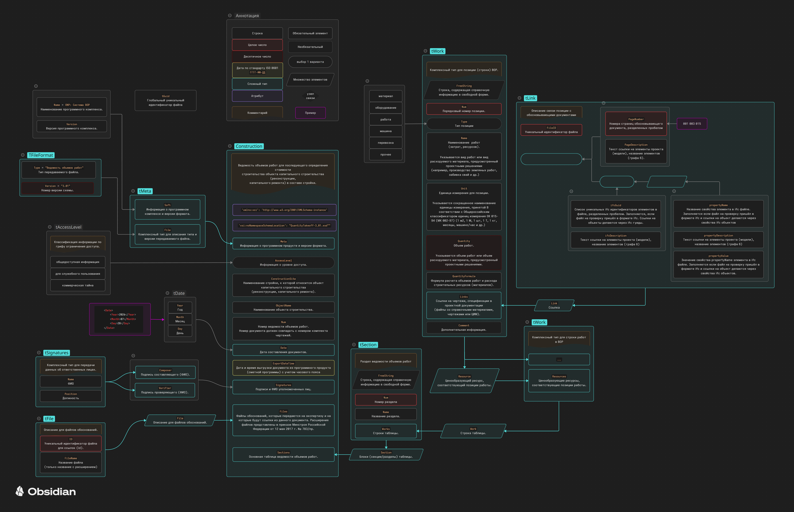

# XML-схема ВОР

Разработанная и утверждённая XSD-схема от Минстроя доступна на [странице](https://www.minstroyrf.gov.ru/tim/xml-skhemy/vedomost-obemov-rabot/p11_1/) официального сайта и в данном репозитории.

На данный момент программа поддерживает[^1] экспорт и импорт по следующим спецификациям:

- [актуальная схема версии 3.01](QuantityTakeoff-3_01.xsd)

[^1]: За исключением ссылок на ifc-элементы. Не смотря на потенциальную перспективность обоснования объемов с помощью ЦИМ, исходя из опыта и наблюдений автора, в текущим реалиях этот функционал излишен для целевой аудитории данного проекта

## Визуализация XML-схемы данных

